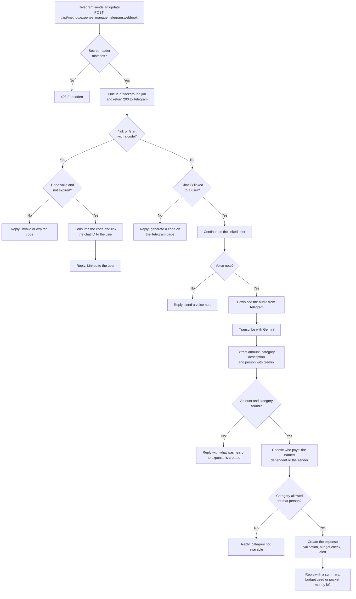
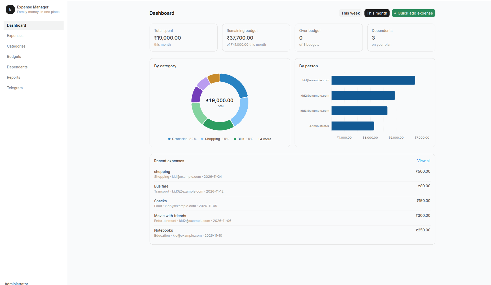
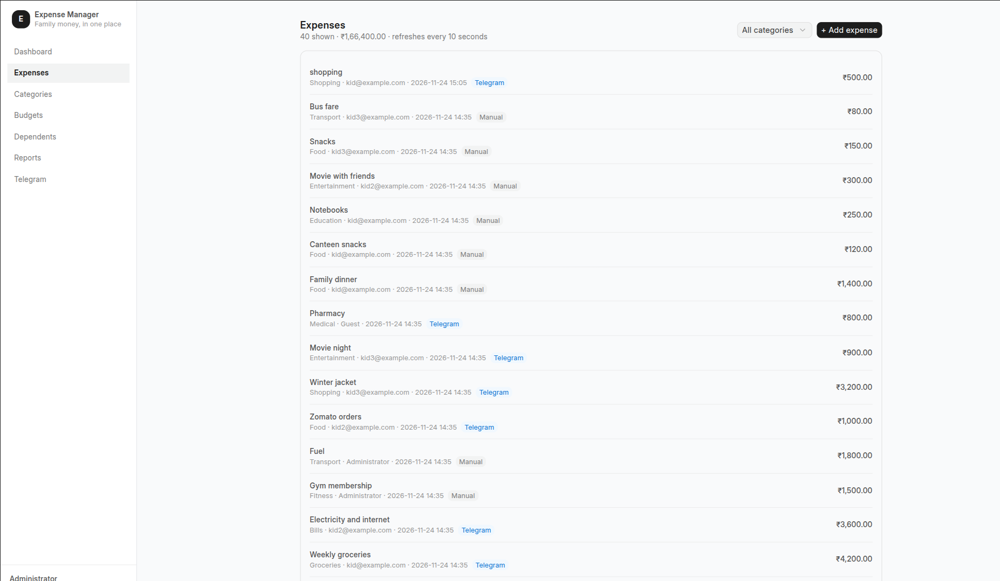
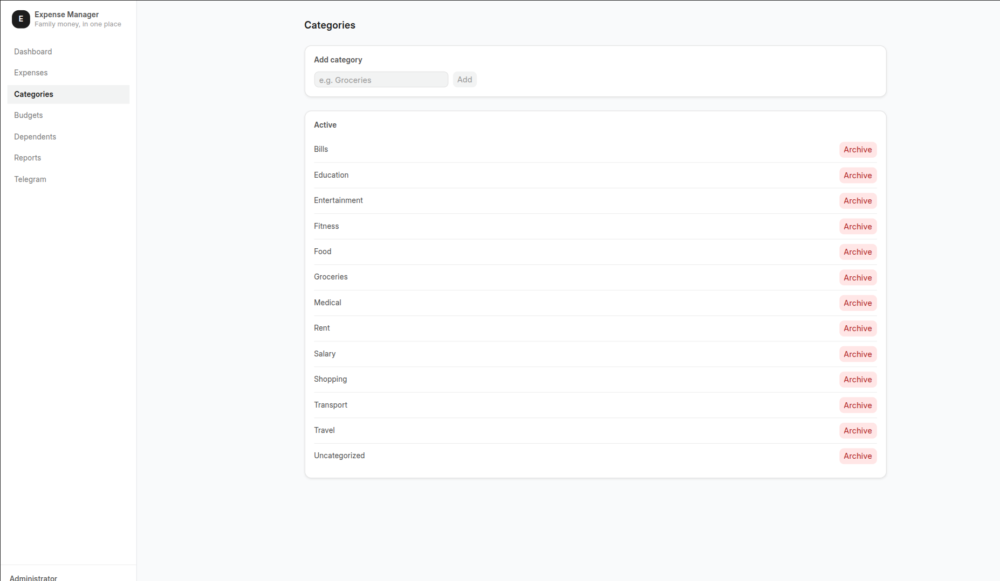
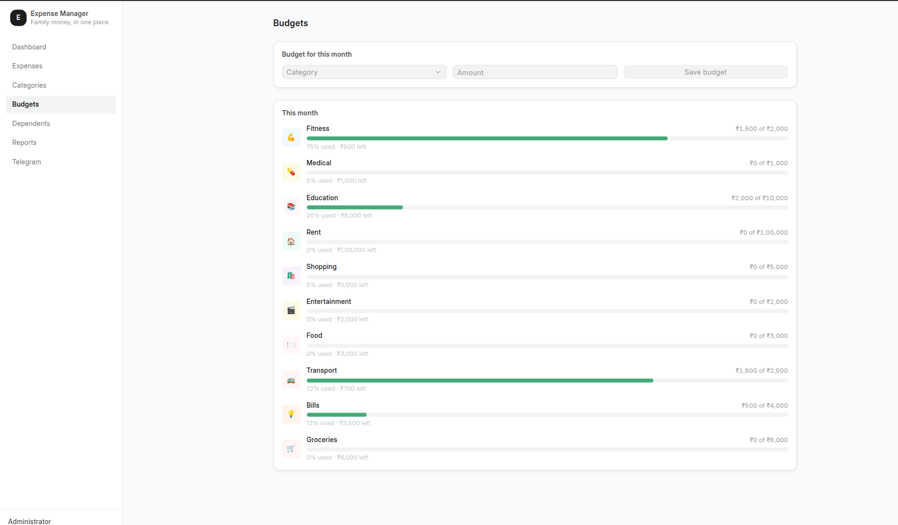
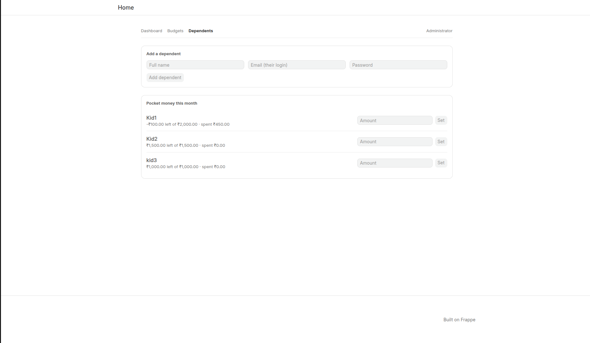
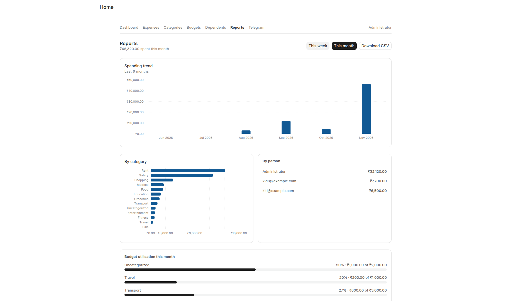
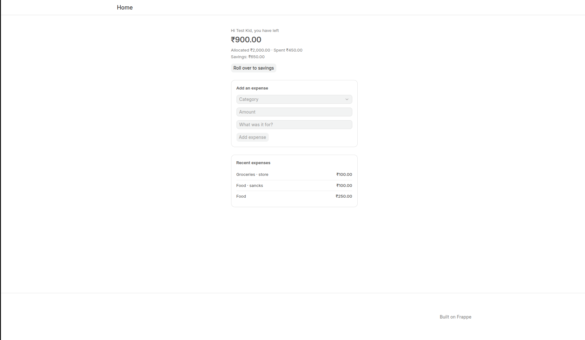
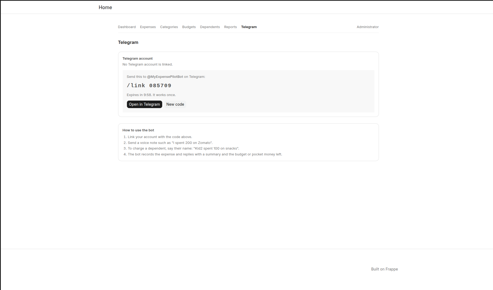
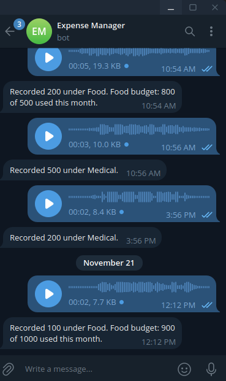

# Expense Manager

A Frappe app for managing personal and family expenses. Individuals set up categories and budgets, add dependents and allocate pocket money, and log expenses by sending a Telegram voice note. Dependents get a simple web portal for their balance, expenses and savings, with no Desk access.

## 1. Project Overview

**Audience:** individuals managing their own spending and a family member's pocket money, such as a parent with a child, who need a low-friction way to log expenses.

**Tech stack**
- **Backend:** Frappe Framework v15 (Python 3.12, MariaDB, Redis, Bench)
- **Frontend:** Vue 3 + Vite + Tailwind CSS 3 + Frappe UI (including its chart components)
- **Bot interface:** Telegram Bot API through a secret-protected, guest-whitelisted webhook
- **AI layer:** Google Gemini for both voice transcription and expense extraction
- **Scheduler:** Frappe scheduler for the monthly savings rollover
- **Tunnel:** ngrok for local webhook ingress during development

## 2. Key Features

### Individual (web app)
- **Dashboard:** total spent, a donut chart by category and a bar chart by person, with a week/month toggle. The report covers you and your dependents.
- **Budgets:** create expense categories, set a monthly budget per category, and see spend against each budget, in red when over.
- **Overspend alerts:** adding an expense checks the month's total for its category against the budget and sends a notification.
- **Dependents:** create a dependent with their own login, allocate monthly pocket money, and see each dependent's remaining balance.
- **Quick add:** a button on the dashboard opens a modal to record an expense without leaving the page.
- **Overspend banner:** categories over budget are flagged at the top of the dashboard, with the amount over.
- **Expenses page:** every expense, newest first, with who spent it and whether it came from Telegram. It refreshes every 10 seconds, so a voice note appears without a reload. It can be filtered by category.
- **Categories:** archive a category instead of deleting it, so old expenses keep their history, and restore it later. Archived categories disappear from forms and from the bot.
- **Allowed categories per dependent:** switch off categories a dependent should not use. The rule is enforced on the server, so it covers the portal and the Telegram bot.
- **Reports:** a six month spending trend, breakdowns by category and person for a week or a month, budget utilisation, and a CSV download.
- **Telegram page:** generate a one-time six digit code to link a Telegram account, see whether it is linked, and unlink it.

### Dependent (web portal, no Desk access)
- See pocket money left this month, with allocated, spent and saved amounts.
- Add expenses and see recent spending.
- Roll unused pocket money over to savings, manually or automatically at month end.

### Telegram bot
- Send a voice note such as "I spent 200 on Zomato". The bot transcribes it, extracts the amount, category and description, creates the expense, and replies with a summary and the remaining budget.
- Only categories that already exist are matched. If nothing matches, the bot replies with what it heard instead of guessing.
- **Account linking:** a user generates a six digit code on the Telegram page and sends `/link CODE` to the bot. Codes expire after 10 minutes and work once.
- **Charging a dependent:** a guardian can say a dependent's name in the voice note ("Kid2 spent 100 on snacks") and the expense is charged to that dependent. Dependents can also link their own Telegram account.
- The reply shows the budget used for the category, or the pocket money left when the expense belongs to a dependent.

## 3. Architecture

```
                 +-----------------------------+
                 |   Telegram user (voice)     |
                 +--------------+--------------+
                                | webhook POST (secret header)
                                v
                 +-----------------------------+
                 |   ngrok tunnel (dev)        |
                 +--------------+--------------+
                                |
                                v
+----------------+  REST   +------------------------------------+
| Vue 3 SPA      +-------->+ Frappe backend (Python)            |
| (Frappe UI)    | session | - api.py          endpoints        |
+----------------+ + CSRF  | - telegram.py     webhook + AI     |
                           | - permissions.py  ownership rules  |
                           | - doctype/*       domain logic     |
                           +-----------------+------------------+
                                             |
                       +---------------------+---------------------+
                       v                                           v
        +-----------------------------+          +-----------------------------+
        | Frappe ORM and MariaDB      |          | Google Gemini API           |
        | Expense, Budget, Dependent, |          | - audio transcription       |
        | Pocket Money Allocation,    |          | - expense extraction (JSON) |
        | Savings Entry, Category     |          +-----------------------------+
        +-----------------------------+
```

**Telegram flow:** the webhook verifies the secret header and queues a background job, so Telegram gets an immediate response. The job looks up the user by chat ID, downloads the voice file, transcribes it, extracts the expense as JSON using the user's existing categories, creates the expense through the shared `create_expense` function, and replies with a summary.

**Web flow:** the Vue app calls whitelisted methods under `expense_manager.api.*`, authenticated with the Frappe session cookie and CSRF token. Individuals see the dashboard, budgets and dependents pages. A dependent is routed to the portal, decided by `get_profile`.

**Access control:** the `Individual` role has Desk access. The `Dependent` role has none. Permission query conditions limit every DocType to its owner's records, so a dependent only reads their own data and an individual reads their own and their dependents'.

### Telegram Bot Message-Handling Flow



| Situation | What the bot does |
| --- | --- |
| Request without the correct secret | Rejects it with `403` and does nothing else |
| `/link CODE` with a valid code | Links the chat to the account, then confirms. The code cannot be used again |
| `/link CODE` with a wrong or expired code | Asks the user to generate a new one on the Telegram page |
| Message from an unlinked chat | Explains how to link the account |
| Text message from a linked chat | Reminds the user to send a voice note |
| Voice note with no clear amount or category | Replies with what it heard and creates nothing |
| Voice note naming a dependent | Charges the expense to that dependent. Their category switches and budgets apply |
| Category archived or switched off for the payer | Refuses with a message instead of guessing another category |
| Any failure while processing, such as an API timeout | Logs the error and replies "Could not process that voice note" |

### Project structure

```
expense_manager/
├── api.py                      Whitelisted endpoints for the frontend
├── telegram.py                 Webhook, transcription, extraction, replies
├── permissions.py              Ownership rules for each DocType
├── hooks.py                    Scheduler, permissions, routing, fixtures
├── fixtures/                   Roles and the telegram_chat_id field
├── expense_manager/doctype/
│   ├── expense_category/
│   ├── budget/
│   ├── expense/                Overspend check, shared expense creation
│   ├── dependent/              Pocket money balance and savings rollover
│   ├── pocket_money_allocation/
│   ├── savings_entry/
│   └── expense_manager_settings/
└── www/expense-manager/        Page that serves the Vue app
frontend/                       Vue 3 + Vite + Frappe UI source
```

## 4. Setup and Running Locally

### Prerequisites
A working Frappe v15 bench (Bench CLI, Python 3.12, MariaDB, Redis, Node.js 20+).

### 1. Install the app
```bash
bench get-app https://github.com/thokalayashwanth1/expense-manager --branch main
bench --site <your-site> install-app expense_manager
bench --site <your-site> migrate
```
The `Individual` and `Dependent` roles and the `telegram_chat_id` field on User are installed automatically as fixtures. Give your own user the `Individual` role.

### 2. Build the frontend
```bash
cd apps/expense_manager/frontend
npm install --legacy-peer-deps
npm run build
```
During development, `npm run dev` rebuilds on every change.

### 3. Configure credentials
Open **Expense Manager Settings** and fill in:

| Field | Value |
| --- | --- |
| `telegram_bot_token` | Token from @BotFather |
| `gemini_api_key` | Key from Google AI Studio |
| `webhook_secret` | Any random string of letters and numbers, for example from `openssl rand -hex 16` |

Secrets are stored in Password fields and never committed.

### 4. Connect the Telegram bot
Telegram needs a public HTTPS address. Start a tunnel and register the webhook:
```bash
ngrok http 8000
curl "https://api.telegram.org/bot<TOKEN>/setWebhook" \
  -d "url=<PUBLIC_URL>/api/method/expense_manager.telegram.webhook" \
  -d "secret_token=<WEBHOOK_SECRET>"
```
Then open the **Telegram** page in the app, generate a link code and send `/link CODE` to the bot. The secret in `setWebhook` must equal `webhook_secret` in the settings, otherwise the webhook returns `403`.

### 5. Open the app
Visit `/expense-manager`. Individuals see the dashboard, budgets and dependents pages. Dependents are sent to their portal and have no Desk access.

## 5. API

| Endpoint | Purpose |
| --- | --- |
| `expense_manager.api.get_profile` | Current user, and the dependent record if they are one |
| `expense_manager.api.get_expense_report` | Totals by person and category for a week or month |
| `expense_manager.api.get_budget_status` | This month's budgets with amount spent |
| `expense_manager.api.set_budget` | Create or update this month's budget for a category |
| `expense_manager.api.add_dependent` | Create a dependent and their login |
| `expense_manager.api.get_dependents` | Dependents with their pocket money balance |
| `expense_manager.api.set_pocket_money` | Set this month's allowance for a dependent |
| `expense_manager.api.add_expense` | Record an expense |
| `expense_manager.api.get_allowed_categories` | Enabled categories this user may spend on |
| `expense_manager.api.set_category_enabled` | Archive or restore a category |
| `expense_manager.api.set_dependent_categories` | Switch categories off for a dependent |
| `expense_manager.api.get_monthly_trend` | Monthly totals for the last six months |
| `expense_manager.api.generate_link_code` | One-time code for linking Telegram |
| `expense_manager.api.get_telegram_status` | Whether this user is linked, and the bot username |
| `expense_manager.api.unlink_telegram` | Remove the Telegram link |
| `...doctype.dependent.dependent.get_pocket_money_balance` | Allocated, spent, saved and remaining amounts |
| `...doctype.dependent.dependent.roll_over_to_savings` | Move the remaining balance into savings |
| `expense_manager.telegram.webhook` | Telegram webhook, protected by the secret header |

## 6. Design Notes

- **No raw SQL:** queries use `frappe.qb`, `frappe.get_list` and `frappe.db.get_value`.
- **One place for each rule:** month spend, expense creation, the family lookup and the pocket money balance each live in one function, shared by the web app, the Telegram bot and the scheduler.
- **Idempotent rollover:** once a month is rolled over its balance is zero, so a repeat call, or the scheduler running twice, creates nothing.
- **Archive, not delete:** categories are switched off with an `enabled` flag, because expenses link to them. The check lives in the Expense validation, so every entry point obeys it.
- **Resilient AI calls:** Gemini requests retry on 429, 500 and 503 with backoff, with a timeout short enough to fail before the background job does.
- **One AI vendor:** Gemini handles both transcription and extraction, so a single key covers the voice flow.

## 7. Demo Video

**Watch the walkthrough:** [Demo video](https://drive.google.com/file/d/1FwIz8zPr3fOJ9JcogH95bEe30vvodFQ3/view?usp=sharing)

## 8. Screenshots

### Dashboard
Summary cards, overspend banner, quick add, category and person charts, and recent expenses.



### Expenses
Every expense, newest first, with the person and source. Voice notes appear here within seconds.



### Categories
Archive a category instead of deleting it, and restore it later.



### Budgets
Monthly budget per category, shown in red when exceeded.



### Dependents
Pocket money allocation, remaining balance, and per-dependent category switches.



### Reports
Six month trend, breakdowns by category and person, budget utilisation, and CSV export.



### Dependent portal
What a dependent sees: balance, add expense, recent spending, and rollover to savings.



### Telegram account link
A one-time code generated in the app and sent to the bot as `/link CODE`.



### Telegram voice capture
A voice note turned into an expense, with a budget summary in the reply.



## Tests

```bash
bench --site test.localhost set-config allow_tests true
bench --site test.localhost run-tests --app expense_manager
```

The tests run on a separate site and roll back after each case. They cover the overspend notification, blocked categories, monthly spend per category, the pocket money balance, a rollover that moves the balance once and a second call that does nothing, an overspent dependent rolling over nothing, isolation between two dependents, an individual seeing their dependents' expenses, and an individual adding a dependent.

## 9. Known Limitations and Deferred Work

- **Voice only on Telegram:** the bot logs expenses from voice notes. Plain text messages get a reminder to send a voice note, and there are no chat commands such as balance or report yet.
- **Current month only:** budgets and pocket money are set for the current month, not for past or future months.
- **Gemini free tier:** the free quota can return timeouts or 503 errors at busy times. The retries cover most cases, but a failed voice note asks the user to try again.
- **Ephemeral tunnel in development:** ngrok's free URLs can change on restart, so the webhook must be registered again.
- **No self-service signup:** accounts are created by an administrator, and dependents are created by an individual from the Dependents page.

## License

MIT
